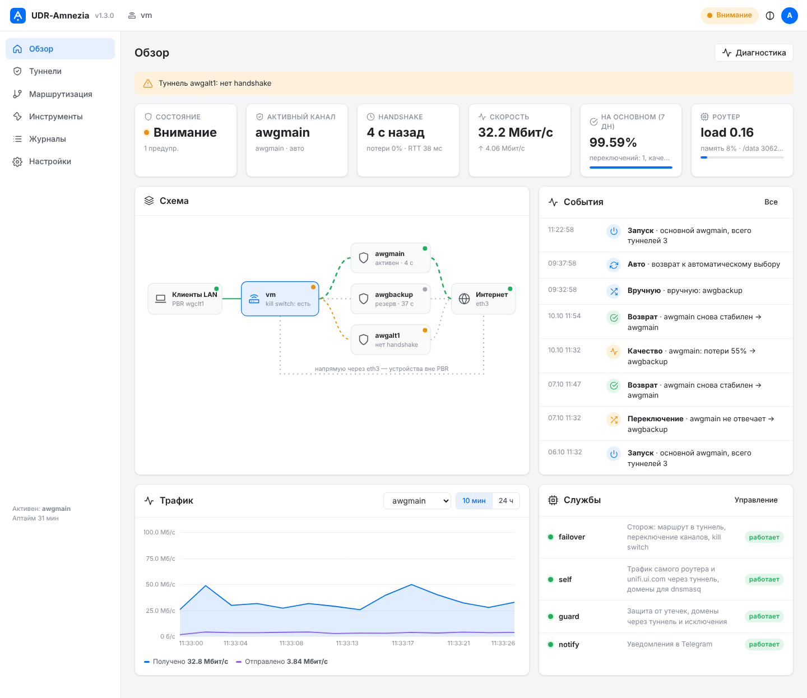
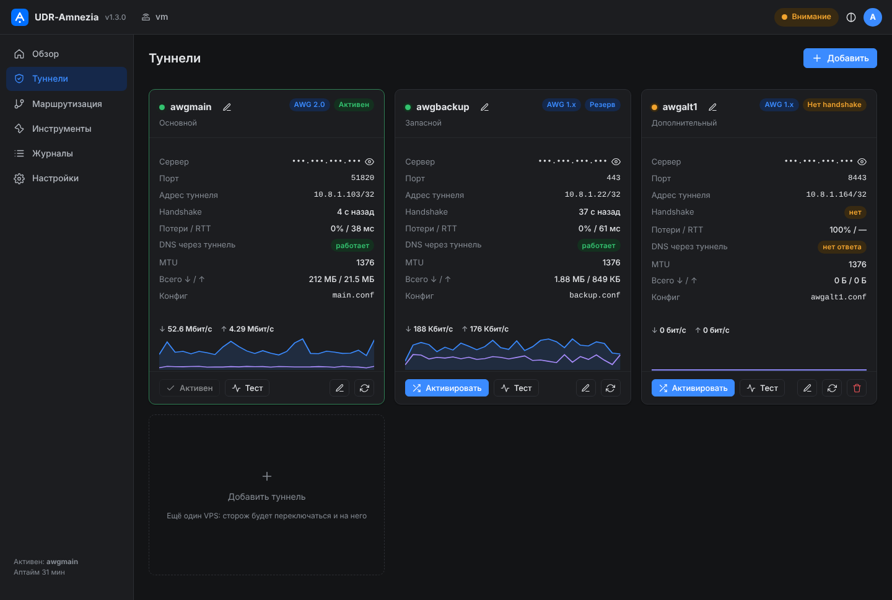
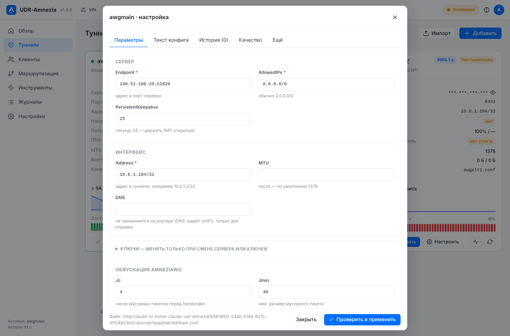
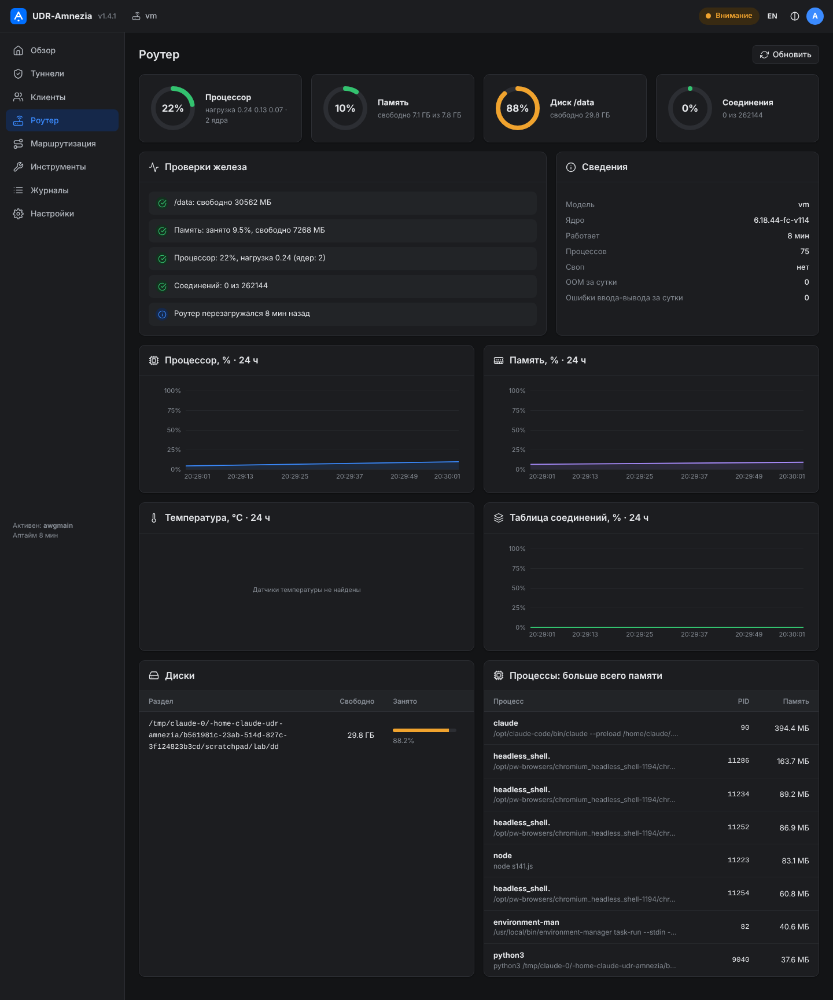
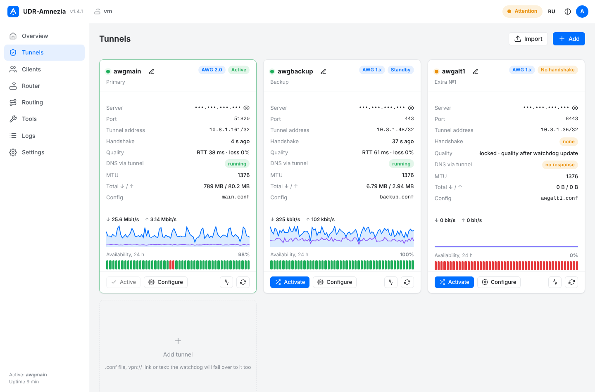

# AmneziaWG для UniFi Dream Router 7
Пошагово можно посмотреть в html на Github https://stebasha.github.io/UDR-Amnezia/

Туннель AmneziaWG прямо на UDR7, встроенный в штатные правила **Policy-Based Routes** UniFi: в туннель уходят только те устройства, сети и домены, которые вы выбрали в интерфейсе UniFi. По желанию: запасной канал на своём VPS с автопереключением, защита от утечек, трафик самого роутера и unifi.ui.com через туннель, панель состояния, аудит и самопроверка, уведомления и бот в Telegram, веб-панель управления в стиле UniFi.

## Быстрая установка

На роутере по SSH под root:

```bash
bash <(curl -fsSL https://raw.githubusercontent.com/stebasha/UDR-Amnezia/main/install.sh)
```

Мастер спросит сценарий, конфиги и опции, проверит каждый шаг и при ошибке предложит варианты. Повторный запуск открывает меню обслуживания:

```bash
/data/awg/install.sh              # меню: обновление, компоненты, диагностика, удаление
/data/awg/install.sh --update     # обновить скрипты, конфиги сохраняются; при сбое — автоматический откат
/data/awg/install.sh --web        # включить или перенастроить веб-панель
/data/awg/install.sh --restore    # после обновления прошивки UniFi
/data/awg/install.sh --status     # панель состояния
/data/awg/install.sh --selftest   # самопроверка всей схемы (--full: ещё и kill switch)
/data/awg/install.sh --uninstall
```

**Обновление с версий 1.0 и 1.1.** Начиная с 1.5 их встроенный `--update` не поддерживается: старые установщики перезаписывали сами себя во время работы. Обновляйтесь командой, которая запускает уже новый установщик:

```bash
bash <(curl -fsSL https://raw.githubusercontent.com/stebasha/UDR-Amnezia/main/install.sh) --update
```

Обновление сохраняет конфиги и настройки, убирает накопившиеся дубликаты правил iptables и перезапускает службы.

## Home Assistant

С 1.5 роутер появляется в Home Assistant сам — через MQTT discovery (интеграция MQTT в HA и брокер, например Mosquitto). Настройка: панель → «Настройки → Home Assistant» (адрес брокера, логин, пароль, TLS) → «Проверить подключение».

- **Датчики:** активный канал, состояние и число замечаний, kill switch, процессор, память, температура, свободно в `/data`; по каждому туннелю — связь, handshake, RTT, потери, трафик.
- **Управление:** «Канал» (авто или конкретный туннель — как «Активировать»/«Автовыбор» в панели), кнопки перезапуска туннелей. Кнопка перезагрузки роутера — только если её явно включить.
- Служба `awg-ha` (Python, только стандартная библиотека). Действия из HA пишутся в журнал панели от имени `homeassistant`. Ключи туннелей в MQTT не публикуются.
- Без MQTT — REST: токен API («Пользователи и 2FA → Токены API») и `GET /api/overview` с заголовком `Authorization: Bearer …`.

## Обновление прошивки UniFi

С 1.5 сторож при каждом старте сверяет версии UniFi OS и Network с запомненными (`/data/awg/.fwver`). Если прошивка сменилась — службы набора восстанавливаются автоматически, запускается самопроверка, в журнале событий появляется «Прошивка», в Telegram приходит итог. Вручную: `/data/awg/install.sh --restore`.

| Роутер | UniFi OS | Network | Проверено с версией набора |
|---|---|---|---|
| UDR7 | 5.1.x (5.1.33) | 10.6.x (10.6.106) | 1.4.x–1.5 |

Если у вас другая связка версий и что-то не так после обновления прошивки — пришлите `awgctl report` в issue.

## Каналы обновлений

С 1.5 обновления идут по каналам (выбор — в «Настройки → Система и обновление» или ключом установщика):

- **stable** (по умолчанию) — последний релиз GitHub. Архив скачивается вместе с `SHA256SUMS`, сумма проверяется; подменённый архив не устанавливается.
- **beta** — ветка `main`: то, что уже влито, но ещё не выпущено релизом.
- **своя ветка** — для проверки изменений до слияния.

```bash
/data/awg/install.sh --channel stable     # перейти на релизы и обновиться
/data/awg/install.sh --channel beta       # ветка main
/data/awg/install.sh --channel имя-ветки  # своя ветка
```

Канал хранится в `/data/awg/.channel`. Если релизов в репозитории ещё нет, stable берёт ветку `main`.

## Веб-панель

Управление из браузера вместо терминала: `https://IP_РОУТЕРА:4443/`. Включается одной командой `/data/awg/install.sh --web` (или мастер и обновление предложат сами).



| | |
|---|---|
|  |  |
|  |  |

- **Обзор:** состояние, активный канал, handshake, скорость, доля времени на основном канале, схема подключения, график трафика (10 минут и сутки), события, службы, клиенты в туннеле, доступность каналов за сутки; перезагрузка роутера с подтверждением паролем.
- **Туннели:** карточки с доступностью за сутки; «Активировать», «Автовыбор», тест (HTTPS, DoH, внешний IP, MTU), перезапуск.
  - Редактор: форма по разделам с проверкой значений, предпросмотр изменений построчно, правка текстом, замена файлом, история версий с возвратом, качество (RTT, потери, замеры скорости), экспорт, порядок, удаление.
  - Импорт: перетащить `.conf`, вставить текст или ссылку `vpn://` из AmneziaVPN → новый туннель или замена конфига.
  - Ключи не показываются и не покидают роутер; если туннель с новым конфигом не поднялся — возвращается прежний.
- **Клиенты:** какие устройства сейчас идут через туннели, с именами из DHCP.
- **Роутер:** процессор, память, диск, температура, таблица соединений — кольца и графики за сутки, проверки железа с советами и прогнозом заполнения диска, процессы.
- **Маршрутизация:** PBR (таблица, метка, kill switch), домены через туннель, исключения, защита от утечек (IPv6 — блокировать или через туннель), подсети VPN-сервера, облако UniFi.
- **Инструменты:** диагностика с причиной и командой исправления, самопроверка и проверка kill switch, тест переключения, проверка домена, скорость каналов, ping и трассировка через туннель, сверка правил с эталоном, MTU, автоподбор параметров обфускации, аудит, отчёт для issue.
- **Журналы:** события с фильтром и статистикой, сторож, systemd, уведомления, бот, установка, обновление, действия в панели.
- **Настройки:** переключение, службы, Telegram, Home Assistant, пользователи, 2FA (QR-код), активные сеансы, порт и сертификат (в т. ч. автообновляемый сертификат UniFi), резервные копии с проверкой, перенос настроек, обновление с откатом.
  - **Маршруты:** разные туннели для разных профилей PBR UniFi (устройства и домены), свой сторож и kill switch у каждого.
  - **Свой VPS:** мастер «адрес + пароль → сервер и туннель», несколько серверов, состояние, обновление AmneziaWG, смена ключей и обфускации, сборка бинарников для роутера.
  - **3x-ui:** несколько панелей по API-токену; создать туннель AmneziaWG 3.1, привязать работающий, подключить к существующему клиенту, «Обновить из 3x-ui».

Язык: русский и английский (переключатель EN/RU). Вывод команд можно скопировать или скачать, журналы и отчёт — скачать файлом.

Безопасность: только LAN-адрес роутера и частные сети, HTTPS (свой или сертификат UniFi), пароли PBKDF2-SHA256, 2FA TOTP, сессии HttpOnly/SameSite=Strict, защита от CSRF и DNS rebinding, блокировка после 5 неудачных входов, ограничение частоты запросов, настраиваемое время жизни сеансов, пароль для опасных действий (перезагрузка, удаление туннеля, импорт настроек, изменения на VPS), журнал действий с ротацией, строгая CSP, без внешних библиотек и CDN. Команды — только из списка разрешённых, параметры проверяются. Нужен `python3` на роутере (только стандартная библиотека). Панель не меняет настройки UniFi и не трогает его порты.

```bash
awgctl web                        # адрес панели и состояние службы
awgctl web passwd admin           # сменить пароль (или добавить пользователя)
awgctl web totp-off admin         # выключить 2FA, если потерян телефон
awgctl drift                      # сверка правил с эталоном (repair — вернуть правила набора)
```

План проверки (1.4–1.6): [docs/TESTPLAN-1.4.md](docs/TESTPLAN-1.4.md).

## Telegram-бот

Меню кнопками: состояние, каналы (переключение с подтверждением, автовыбор, тест, скорость), события и статистика, проверки (диагностика, самопроверка, проверка сайта, отчёт файлом), роутер, клиенты в туннеле, тишина уведомлений, службы. Несколько получателей: администраторы (`TG_CHAT`) и «только просмотр» (`TG_VIEWERS`) — задаются в панели: Настройки → Telegram. Уведомления о переключениях и проблемах роутера приходят всем, с кнопками.

Те же уведомления можно получать **вебхуком** (POST JSON `{"source","host","level","time","text"}`, необязательный заголовок для авторизации) и в **ntfy** (ntfy.sh или свой сервер, приоритет по важности события) — Настройки → Telegram → «Вебхук и ntfy». Работает и без Telegram; адреса в LAN (Home Assistant, свой ntfy) подходят — отправка идёт обычным маршрутом роутера.

## Сценарии

| | Что у вас есть | Что делает мастер |
|---|---|---|
| **A** | Конфиг AmneziaWG от VPN-провайдера | Поднимает туннель, подключает к PBR, ставит сторожа |
| **B** | Свой VPS (Ubuntu/Debian, root, белый IP) | Сам заходит на VPS по SSH, собирает и настраивает сервер AWG, забирает конфиг |
| **C** | Конфиг провайдера + свой VPS | Основной + запасной туннель, автопереключение за ~15 с, возврат через 10 минут стабильной работы |

## Возможности

**Туннель и PBR**
- Туннели AmneziaWG в userspace (`amneziawg-go`): модуля AWG в ядре UDR7 нет, `/dev/net/tun` есть. Поддерживаются конфиги AWG 1.x и 2.0 (`S3`, `S4`, `I1…I5`, `HeaderProtectionKey`).
- Встраивание в штатный PBR UniFi: профиль VPN Client используется как «рельса» (метка и таблица), трафик в туннель выбирается в интерфейсе UniFi. Таблица, метка и профиль находятся автоматически; если правила нет, установщик сгенерирует фиктивный профиль и покажет шаги в UniFi.
- Свой VPS настраивается по SSH с роутера: сборка, ключи, случайные или проверенные параметры обфускации, автозапуск, получение `client.conf` и удаление его копии на сервере.
- Диагностика туннеля с двух сторон (tcpdump на WAN роутера и на VPS) с понятным выводом: порт у хостера, ключи, параметры обфускации, DPI.

**Надёжность**
- Сторож `awg-failover`: автопереключение основной ↔ запасной и возврат после `RECOVER_SEC` стабильной работы.
- Kill switch: `blackhole` в таблице PBR ставится при старте сторожа и остаётся при его остановке и перезапуске. Если туннели лежат, трафик под PBR стоит, а не уходит через провайдера.
- Больше двух туннелей (`TUNNELS_EXTRA`), выбор по качеству канала (потери и задержка), ручное переключение `awgctl switch` / `awgctl auto`, журнал событий и статистика.
- При переключении сбрасываются записи conntrack прежнего туннеля, чтобы UDP-потоки (звонки, игры) не зависали на старом адресе.
- Все вызовы iptables идут с `-w`, правило добавляется только при ответе «правила нет», при занятой блокировке xtables ничего не меняется до следующего круга. Сторож и обновление убирают накопившиеся дубликаты (`awgctl dedup`), аудит и самопроверка их показывают.
- Цепочки собираются целиком и подменяются, параллельные запуски разделены блокировками, сменённые UniFi метка или таблица PBR обнаруживаются и показываются.

**Маршрутизация и защита (awg-guard, awg-self, awg-subnets)**
- Защита от утечек: пакеты с меткой PBR не выпускаются в WAN, IPv6 трафика под PBR и клиентов VPN-сервера роутера блокируется. Список WAN-интерфейсов только растёт, поэтому переподключение PPPoE защиту не снимает.
- Клиенты VPN-сервера роутера (WireGuard Server, Teleport) через туннель: правила `ip rule` 6100/6101, проверка совпадения с LAN.
- Трафик самого роутера по тем же правилам PBR, unifi.ui.com из РФ через туннель (DNS домена и адреса облака Ubiquiti). Серверы туннелей, DNS роутера, DHCP, подсеть провайдера и ответы на входящие соединения всегда идут мимо туннеля.
- Домены через туннель для выбранных клиентов и исключения из туннеля (домены и подсети). При защите от утечек с блокировкой IPv6 (по умолчанию) IPv6-адреса этих доменов отклоняются, устройства переходят на IPv4. Файл для dnsmasq проверяется перед подключением.
- Подбор MTU по пути до сервера с копией конфига.

**Управление и наблюдение**
- Веб-панель `awg-web` в стиле UniFi: обзор со схемой и графиками, туннели, маршрутизация, инструменты, журналы, настройки; вход по паролю и 2FA, только из LAN.
- `awgctl diagnose`: дерево причин (WAN → туннели → PBR → NAT → IPv6 → службы) с первой причиной и командой исправления. `awgctl domain ДОМЕН`: куда пойдёт сайт и где он открывается. `awgctl report`: обезличенный отчёт для issue.
- `awgctl`: состояние каналов, ручное переключение, события, статистика, внешние IP, самопроверка, MTU, резервные копии, очистка дубликатов.
- `awg-selftest`: самопроверка всей схемы, с `--full` ещё и живая проверка kill switch.
- Панель `awgs` при входе по SSH вместо баннера UniFi, аудит `awg-audit` (лишние правила, дубликаты, права файлов, остатки тестов).
- Уведомления: Telegram, вебхук (JSON) и ntfy. Telegram: события, суточный и недельный отчёты, доставка через туннели с запасным путём через WAN, бот с командами (`/status`, `/switch`, `/selftest`…), предупреждения о месте на `/data`, остановленных службах, пропавшей подсети VPN-сервера.
- Метрики Prometheus (`awg-metrics`): файл для node_exporter или HTTP на LAN-адресе роутера.

**Обслуживание**
- Зашифрованные резервные копии настроек (AES-256), восстановление, перенос ответов мастера на другой роутер (`--record` / `--answers`).
- Свой VPS одной кнопкой: адрес и пароль root — роутер сам кладёт ключ, собирает AmneziaWG, создаёт сервер и туннель («Настройки → Свой VPS → Подключить и настроить»).
- Туннель AmneziaWG 3.1 через 3x-ui (≥ 3.8.5) по API-токену: «Настройки → 3x-ui → Создать туннель»; несколько панелей, привязка уже работающего туннеля к его подключению и «Обновить из 3x-ui», подключение к существующему клиенту.
- Несколько своих VPS: «Свой VPS → Добавить VPS», `awgctl vps --vps ID …`.
- Разные туннели для разных устройств и доменов: правила PBR UniFi на разные профили VPN Client, у каждого — своя цепочка туннелей и свой сторож («Настройки → Маршруты», `awgctl routes`).
- IPv6 через туннель — по желанию, если сервер выдал туннелю IPv6 (по умолчанию IPv6 под PBR блокируется).
- Автоподбор параметров обфускации: перебор, проверка, оценка, лучший — по кнопке («Инструменты», `awgctl tune`).
- Списки и GeoIP — по желанию: через туннель только заблокированное или всё, кроме выбранных стран (например RU, CN, BY, KZ — умный дом с серверами в Китае) — «Маршрутизация → Списки и GeoIP», `awgctl lists`.
- Перехват DNS устройств с «зашитым» DNS (телевизоры, умный дом) на роутер и, по желанию, через туннель; отказ DNS-over-TLS — «Маршрутизация → DNS устройств».
- Маршруты в Telegram-боте (`/routes`, выбор канала) и в Home Assistant.
- Отчёт за неделю/месяц: доступность, задержка, скорость, время на резервном — по каналам и маршрутам; трафик по устройствам (по желанию). Панель и Telegram (`/week`).
- Свой VPS из панели («Настройки → Свой VPS», `awgctl vps`): состояние сервера, обновление AmneziaWG на нём, смена ключей и параметров обфускации на обеих сторонах сразу — с откатом, если туннель не заработал.
- Автокопия вне роутера по расписанию: на свой VPS и/или в Telegram, с проверкой расшифровкой и хранением последних N (панель: «Резервные копии → Автокопия вне роутера»; `backup.sh auto`, `backup.sh vps-test`).
- Восстановление после обновления прошивки (`--restore`), автовосстановление через `/data/on_boot.d` (нужен обработчик on_boot.d).
- Проверка файлов по манифесту (`--verify`), обновление установщика с проверкой SHA-256 (`--self-update`), предпросмотр без изменений (`--dry-run`).
- Бинарники AmneziaWG: `--bins-check` — сравнить с последними официальными релизами amnezia-vpn (и в панели: «Система и обновление → Проверить AmneziaWG»); `--bins-update` — собрать последние релизы на своём VPS и поставить, `--bins-update ПАПКА` — поставить готовые файлы с `SHA256SUMS`. Если после замены туннель теряет handshake, возвращаются прежние файлы.
- Свой VPS: автообновления, fail2ban, вход по ключам (установщик может добавить свой ключ роутера), смена ключей туннеля с автоматическим откатом.
- Полное удаление (`--uninstall`): службы, правила, туннели, команды, баннер; папка с ключами — только по `--purge`.

Подробно: [docs/FEATURES.md](docs/FEATURES.md). История: [CHANGELOG.md](CHANGELOG.md).

## Бинарники AmneziaWG

Только официальные исходники AmneziaVPN: [amnezia-vpn/amneziawg-go](https://github.com/amnezia-vpn/amneziawg-go) и [amnezia-vpn/amneziawg-tools](https://github.com/amnezia-vpn/amneziawg-tools), на закреплённых тегах (переменные `AWG_GO_REF`, `AWG_TOOLS_REF` в начале `install.sh`). Готовых сборок под роутер у AmneziaVPN нет, а компилятора на роутере нет, поэтому есть три пути:

1. **Сборка на вашем VPS по SSH** — установщик делает всё сам и сверяет контрольные суммы.
2. **Сборка на любом компьютере с Ubuntu/Debian** (x86_64 или arm64, в том числе WSL):
   ```bash
   curl -fsSL https://raw.githubusercontent.com/stebasha/UDR-Amnezia/main/server/awg-build-router.sh -o awg-build-router.sh
   bash awg-build-router.sh            # результат: /root/awgbuild/router/{amneziawg-go,awg,SHA256SUMS,BUILDINFO}
   scp /root/awgbuild/router/* root@IP_РОУТЕРА:/tmp/awgbin/
   ```
   затем в установщике «Папка на роутере» → `/tmp/awgbin`.
3. **Свой источник**: папка на роутере или ссылка. Суммы сверяются по `SHA256SUMS` рядом с файлами или по введённым вами (для прямых ссылок на два файла обязательны); без сумм установщик предупредит и спросит подтверждение.

## Что мастер проверяет

- архитектуру (aarch64), UniFi OS, `/dev/net/tun`, нужные команды, место на `/data`, доступ к GitHub;
- остатки старых установок: обычный WireGuard `wgbackup`, тестовые правила, сторонний установщик `/data/awg-native`, ручные экземпляры сторожа (предлагает убрать);
- бинарники AmneziaWG: контрольные суммы обоих файлов и что они запускаются на роутере;
- конфиг: секции, ключи, Address, Endpoint; предупреждает, если это обычный WireGuard без обфускации;
- туннель: внешний IP через интерфейс и handshake; при сбое — диагностика tcpdump на WAN, а для своего VPS одновременно на сервере;
- PBR: таблицу, метку и профиль VPN Client;
- сторожа: маршрут в таблице PBR вместе с `blackhole`, переключение на запасной канал (по желанию, имитацией сбоя);
- расширенные службы: что их правила стоят на своих местах;
- Telegram: токен через `getMe`, chat id автоматически, тестовое сообщение;
- в конце — самопроверку всей схемы.

## Структура

```
install.sh            установщик и меню обслуживания
install.sh.sha256     контрольная сумма для --self-update
VERSION
awg/                  файлы роутера → /data/awg
  up.sh                 поднять туннели из main.conf / backup.conf / <имя>.conf
  failover.sh           сторож: таблица PBR, проверки, переключение, качество, kill switch, dedup
  awg-detect.sh         найти таблицу, метку, профиль PBR → awg.env (остальные настройки сохраняются)
  subnets.sh            клиенты VPN-сервера роутера через туннель (служба awg-subnets)
  guard.sh              защита от утечек, домены через туннель, исключения (служба awg-guard)
  self.sh               трафик роутера и unifi.ui.com через туннель (служба awg-self)
  awgctl.sh             управление: status, switch, auto, events, stats, ip, dedup, routes, vps, tune, lists
  routes.sh             дополнительные маршруты: профиль UniFi → своя цепочка туннелей (служба awg-failover-ID)
  obfs-tune.sh          автоподбор параметров обфускации
  lists.sh              списки заблокированного и GeoIP (наборы ipset для awg-guard)
  vps.sh                свой VPS: мастер, несколько серверов, обновление, ключи и обфускация, бинарники роутера
  selftest.sh           самопроверка (awg-selftest)
  status.sh             панель (awgs)
  audit.sh              аудит (awg-audit)
  notify.sh, awg-notify.sh, bot.sh   Telegram: доставка, события и отчёты, бот
  metrics.sh            метрики Prometheus
  mtu.sh, backup.sh     подбор MTU, резервные копии
  awg-restore.sh        восстановление после обновления прошивки
  awg-uninstall.sh      удаление
  *.service             юниты systemd (копии в /data/awg)
server/               файлы VPS
  awg-server-build.sh   сборка amneziawg-go и awg для сервера (официальные исходники)
  awg-build-router.sh   сборка бинарников для роутера (arm64, статически), SHA256SUMS
  awg-server-setup.sh   ключи, обфускация, служба awg-server
  audit-server.sh       аудит VPS
  vps-harden.sh, vps-rotate.sh   защита VPS, смена ключей
tests/                тесты на заглушках: bash tests/run.sh
tools/sync-guide.py   переносит скрипты из awg/ и server/ в гайд index.html
index.html            подробный гайд с ручной установкой, диагностикой и справочником
```

## Что проверено

- **Вживую на UDR7** (UniFi OS 5.1.33, Network 10.6.106): основная схема версии 1.1 — основной туннель от провайдера с параметрами AWG 2.0, запасной до своего VPS (Ubuntu 24.04), PBR по доменам и адресам, клиенты VPN-сервера роутера, переключение и возврат, панель, аудит, уведомления; awg-self (исправление unifi.ui.com). Тогда использовались бинарники 0.0.20250522.
- **На заглушках** (`bash tests/run.sh`, без роутера): установщик, сторож, guard, awg-self, подсети, удаление; поведение при занятой блокировке xtables, очистка дубликатов, kill switch при остановке сторожа, безопасное обновление со старых версий установщика.
- **Вживую на UDR7, версия 1.6:** бинарники amneziawg-go v3.1 и awg v3.1, собранные на своём VPS из официальных исходников; веб-панель; свой VPS из панели (ключ роутера, состояние, версии); 3x-ui 3.10 (AmneziaWG 3.1, привязка запасного канала, несколько панелей); автоподбор обфускации на запасном канале; дополнительный маршрут на втором профиле PBR UniFi.
- **Пока только на заглушках:** IPv6 через туннель, режим подбора «роутер и свой VPS», автовосстановление on_boot.d. Включайте по одной и смотрите `awgctl selftest`. Сообщайте о проблемах.

## Разработка

```bash
bash tests/run.sh                 # тесты на заглушках, root и роутер не нужны
python3 tools/sync-guide.py       # после правки скриптов: обновить их копии в index.html
sha256sum install.sh > install.sh.sha256   # после правки install.sh (иначе --self-update откажется)
```

CI (GitHub Actions) проверяет синтаксис, shellcheck (предупреждения блокируют), тесты на Python 3.7–3.12 и на aarch64, актуальность `install.sh.sha256` и гайда. Подробнее — [CONTRIBUTING.md](CONTRIBUTING.md); об уязвимостях — приватно, см. [SECURITY.md](SECURITY.md). Об ошибке — issue по шаблону с обезличенным отчётом `awgctl report`.

## Безопасность

- Один конфиг AmneziaWG = одно устройство.
- Конфиги и токены не отправляются в чаты и тикеты; файлы с ключами получают права 600, токен Telegram передаётся curl через stdin и не виден в списке процессов.
- Бинарники только из официальных исходников AmneziaVPN или из указанного вами источника (с проверкой SHA-256, если суммы есть).
- Изменения через CLI выходят за штатную работу устройства. `install.sh --uninstall` убирает всё, что поставил установщик.

PS Все материалы и демонстрации представлены исключительно в образовательных и исследовательских целях для повышения цифровой грамотности. Автор не одобряет и не призывает к неправомерным действиям. Любые действия, совершенные на основе этой информации, вы делаете исключительно на свой страх и риск.  
